# AI Usage Log — NEWITY Lender Comparison Tool

A record of how AI was used to take this project from a written brief to a tested, documented app in one working day (Sep 30, 2026).

## The overall process

The work split cleanly across two tools, and the split was deliberate:

- **The browser (Claude in the browser) was used for planning.** Reading the brief, arguing about scope, resolving ambiguity, choosing a stack, and producing `SPEC.md`. This is conversational, high-context work where the output is a decision, not a file. Nothing was written in this stage except the spec itself.
- **Claude Code was used for building, testing, and documentation.** Once `SPEC.md` existed, every turn happened in the terminal against the real repo — scaffolding, implementing, running the type checker and test suite, driving a real browser, and writing `TEST_PLAN.md`, `DEMO.md`, and the README.

The handoff between the two is the spec. The planning conversation deliberately produced a document with numbered requirements (F1–F28, N1–N13), so that every later prompt and every code comment could cite a requirement number instead of re-litigating a decision that had already been made.

The other consistent pattern: **correction over generation.** Most terminal turns are not "write this feature" — they are "here is what's wrong with what you wrote, fix it." Several of the most valuable moments in this log are the model pushing back and being right, or the model catching that its *own* earlier statement was wrong.

---

## Stage 1 — Understanding

Reading the brief and the data before deciding anything. All in the browser.

### 1.1 The opening prompt

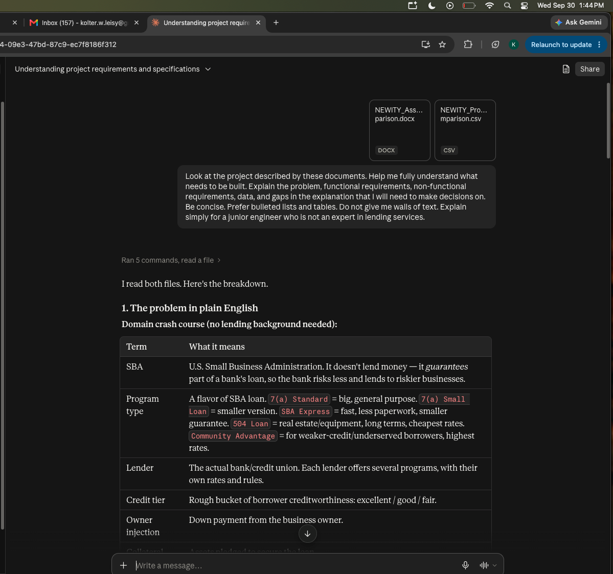

The assignment doc and the rate-sheet CSV were attached together, with an explicit instruction about *format*: bulleted lists and tables, no walls of text, explained for a junior engineer with no lending background. The first output was a domain crash course — what SBA, program type, credit tier, and owner injection actually mean — because none of the later decisions make sense without it.

### 1.2 Functional requirements, sorted by effort against value

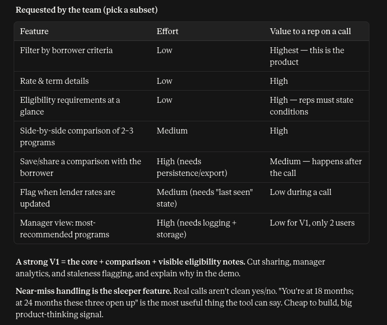

Every requested feature was put in a table with an effort estimate and a value-to-a-rep-on-a-call estimate. This is what made the V1 cut defensible rather than arbitrary: sharing, manager analytics, and staleness flagging were cut because they are high effort and low value *during a live call*, which is the only moment this tool is used.

The near-miss insight surfaced here: real calls aren't clean yes/no, so "you're at 18 months; at 24 these three open up" is the most useful sentence the tool can produce. Cheap to build, and the strongest product signal in the brief.

### 1.3 Naming the ambiguity instead of guessing past it

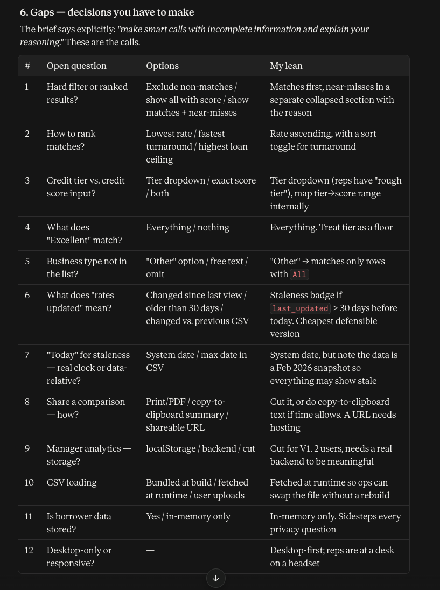

The brief said to "make smart calls with incomplete information and explain your reasoning." Rather than silently making those calls, all twelve were enumerated as open questions, each with its options and a recommended lean — hard filter vs. ranked results, credit tier vs. exact score, what "rates updated" means, whether borrower data is stored, build-time vs. runtime CSV loading.

This turned an unbounded design conversation into a list of twelve decisions to accept or override.

---

## Stage 2 — Scope and architecture

Resolving those twelve questions, settling the zero-match behavior, choosing the stack, and freezing it all into a spec.

### 2.1 Answering the questions and pushing back

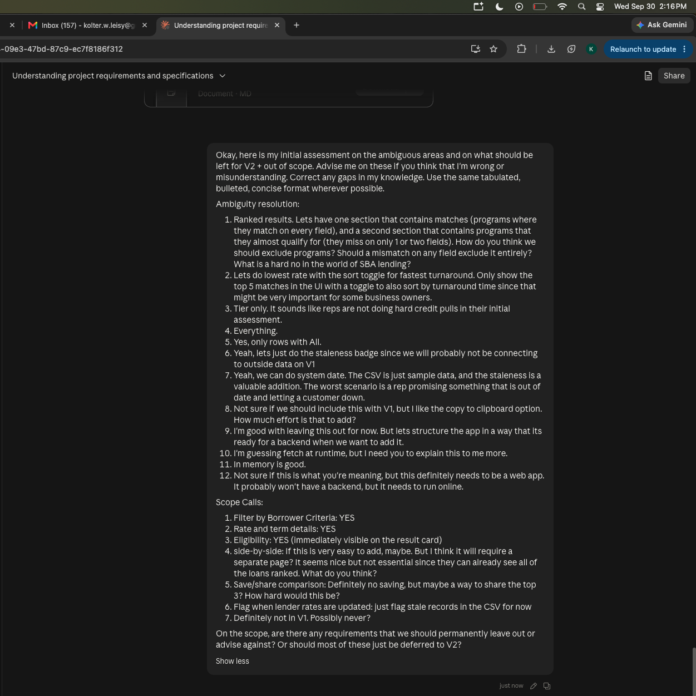

Every open question got an answer, with follow-up questions where the answer wasn't obvious — "how should we exclude programs? Is a mismatch on any field a hard no in the world of SBA lending?" The prompt explicitly invited correction: *"Advise me on these if you think that I'm wrong or misunderstanding."*

Scope calls were made in the same pass: filtering, rate/term details, and eligibility in; saving and manager analytics out.

### 2.2 Designing the empty state on purpose

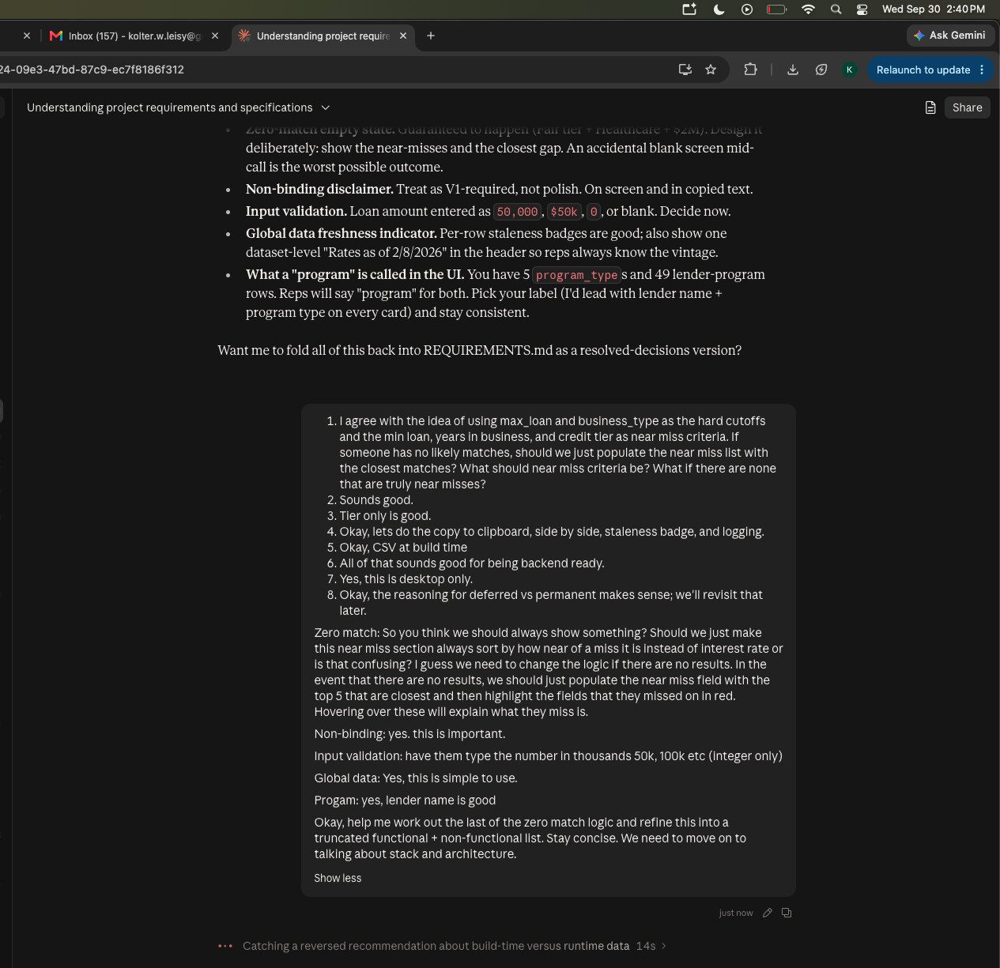

The most important design decision in the app. A blank screen mid-call is the worst possible outcome, and a zero-match result was *guaranteed* to happen with the sample data. The resolution: when nothing matches, always populate a "closest available" list with the five nearest programs and highlight in red exactly which criteria they missed.

Also settled here: the non-binding disclaimer is a V1 requirement rather than polish, input validation rules, and a dataset-level "Rates as of 2/8/2026" header so a rep always knows the vintage of what they're reading.

Worth noting the status line at the bottom of this screenshot — the model catching a reversed recommendation it had made earlier about build-time vs. runtime data, and correcting itself unprompted.

### 2.3 Stack decision: TypeScript, for a specific reason

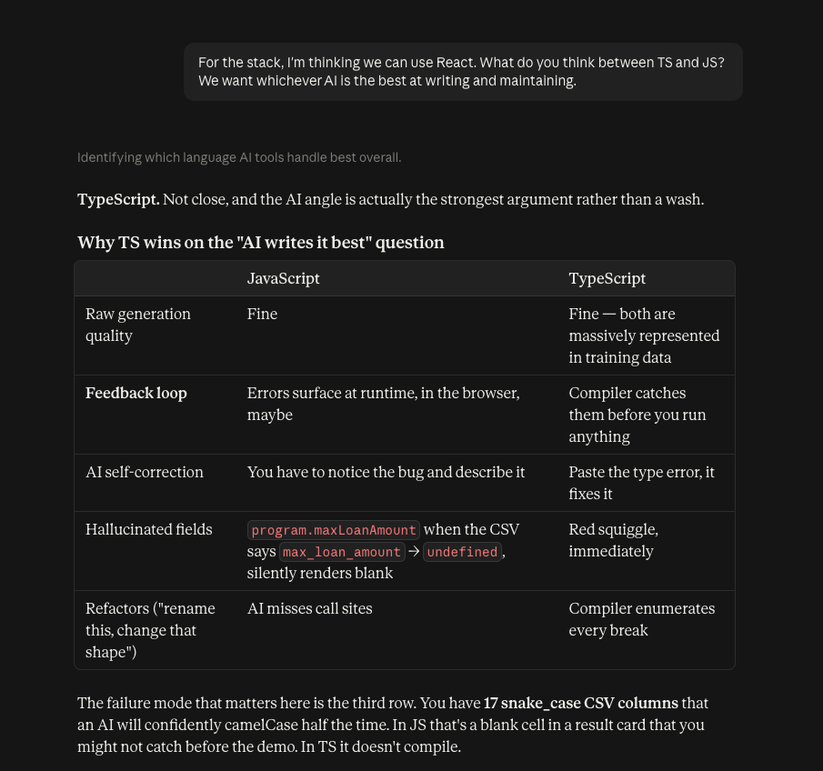

The question asked was narrow: which language is AI best at writing and maintaining? The answer was TypeScript, and the argument was not general type-safety dogma — it was this project's data. The CSV has **17 snake_case columns** that an AI will confidently camelCase half the time. In JavaScript that is a blank cell in a result card that nobody notices before the demo. In TypeScript it doesn't compile.

The feedback loop was the deciding factor: the compiler catches the error before anything runs, and a pasted type error is something the model can fix without a human first noticing the bug.

### 2.4 Freezing it into SPEC.md

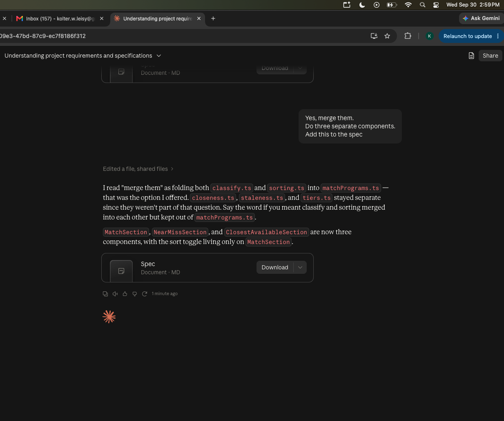

The last architecture turn — merging `classify.ts` and `sorting.ts` into `matchPrograms.ts`, splitting the results UI into three components (`MatchSection`, `NearMissSection`, `ClosestAvailableSection`), and folding both into the spec.

Note the model's clarifying line: it read "merge them" as one specific pairing and said so explicitly, rather than guessing at a broader refactor. That is the last browser turn; from here everything moves to the terminal.

---

## Stage 3 — Building

Claude Code, in the repo, against the real CSV.

### 3.1 Scaffold first, implement nothing

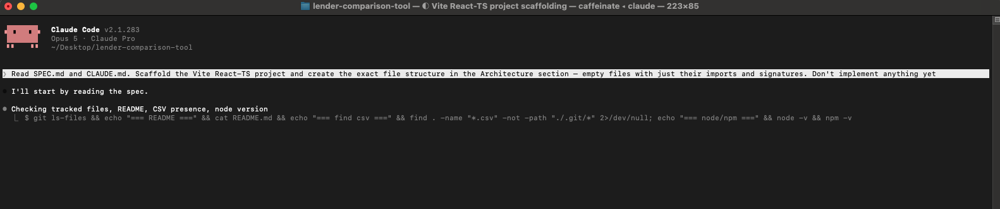

The first terminal prompt deliberately builds *nothing*: read `SPEC.md` and `CLAUDE.md`, create the exact file structure from the Architecture section, empty files with imports and signatures only.

This creates the whole shape of the app before any logic exists, so every subsequent piece can be written against interfaces that already typecheck.

### 3.2 Reviewing the scaffold before trusting it

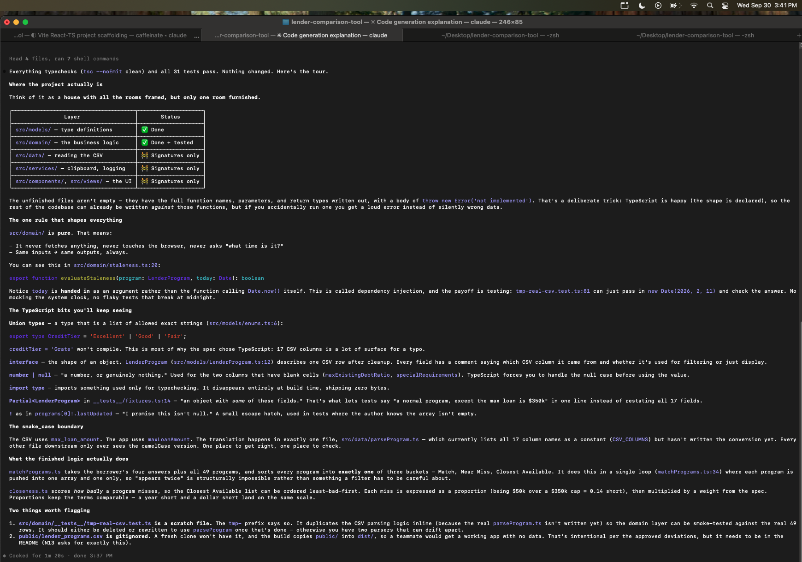

A structured tour of what actually exists — "a house with all the rooms framed, but only one room furnished." The unimplemented files throw `Error('not implemented')` rather than returning empty values, so an accidental call fails loudly instead of producing silently wrong data.

Two architectural rules were confirmed here and held for the rest of the build: `src/domain/` is **pure** (it never fetches, never touches the browser, and takes `today: Date` as an argument instead of calling `Date.now()`, which is what makes the staleness logic testable), and the snake_case→camelCase translation happens in **exactly one file**.

The turn ends by flagging two things that need attention — a scratch test file duplicating parse logic, and the gitignored CSV — rather than reporting clean success.

### 3.3 Implementing the matching logic

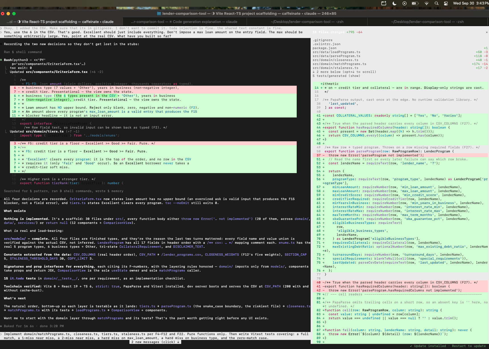

Two corrections fed in mid-build: use the six business types actually present in the CSV, and impose no maximum on the loan amount field (an oversized ask is valid input that should produce the "no programs cover $6,000,000" blocker, not a field-level error).

Both were written back into the code as comments citing their requirement numbers, so the decision lives next to the code rather than in a chat log. The matching function sorts every program into exactly one of three buckets in a single pass, which makes "a program appears twice" structurally impossible rather than something a filter has to be careful about.

### 3.4 Data layer complete, moving to UI

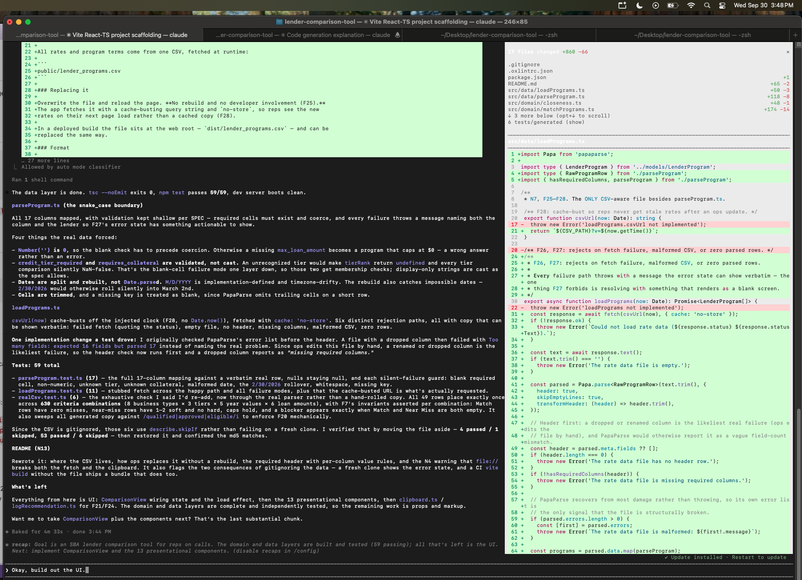

59 tests passing on the domain and data layers before a single component was written. Four things the real data forced, that the spec hadn't anticipated: `Number('')` is `0` (so the blank check has to precede coercion, or a missing max loan silently becomes a $0 cap), display-only strings need validation rather than casting, dates are split and rebuilt rather than `Date.parse`d, and cells are trimmed.

One implementation change was driven by a test: a dropped CSV column originally failed with an unhelpful field-count error, so the header check was moved to run first and now reports "missing required columns."

### 3.5 Verifying in a real browser

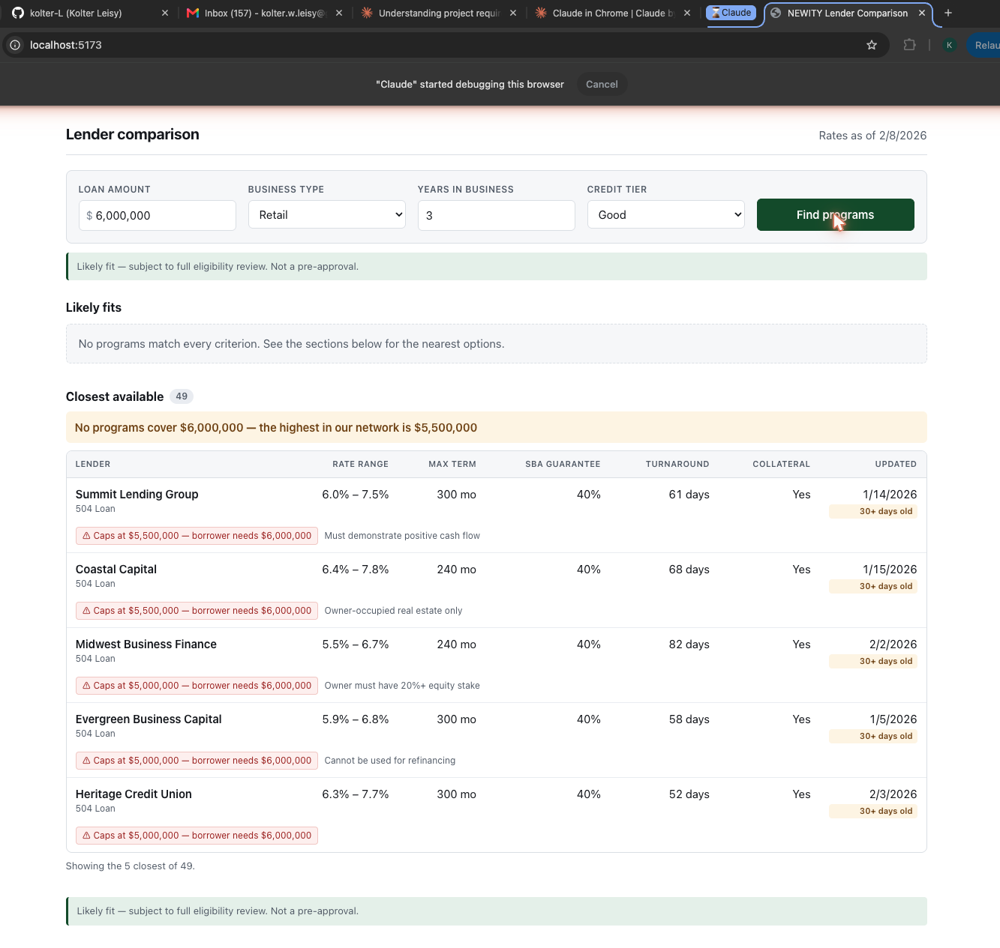

Claude driving Chrome directly against the dev server, exercising the case that mattered most: a $6,000,000 ask that nothing in the network covers. The result is the blocker headline ("No programs cover $6,000,000 — the highest in our network is $5,500,000"), the closest-available list still populated with five programs, each one carrying a red chip naming its exact cap, plus staleness badges and the disclaimer.

This is the zero-match design from Stage 2, confirmed working in the real UI.

---

## Stage 4 — Testing

Review, a written test plan, four rounds of correction, then an automated end-to-end suite.

### 4.1 Security sweep and the start of review

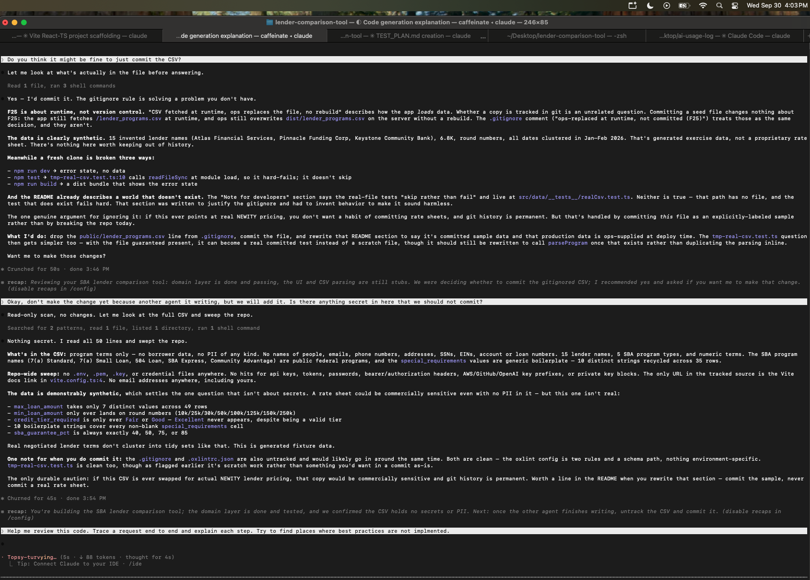

Two things happened here. First, a disagreement: asked whether the CSV should be committed, the model said yes and explained why the gitignore rule was solving a problem that didn't exist — a fresh clone was broken three separate ways, and the README described behavior that didn't actually exist.

Second, a read-only sweep for anything sensitive: no PII, no credentials, no keys anywhere in the repo, and positive evidence that the data is synthetic (seven distinct loan caps across 49 rows, guarantee percentages always exactly 40/50/75/85). The one durable caution — if this file is ever swapped for real NEWITY pricing, git history is permanent — was recorded in the README rather than just said out loud.

### 4.2 A bounded test plan

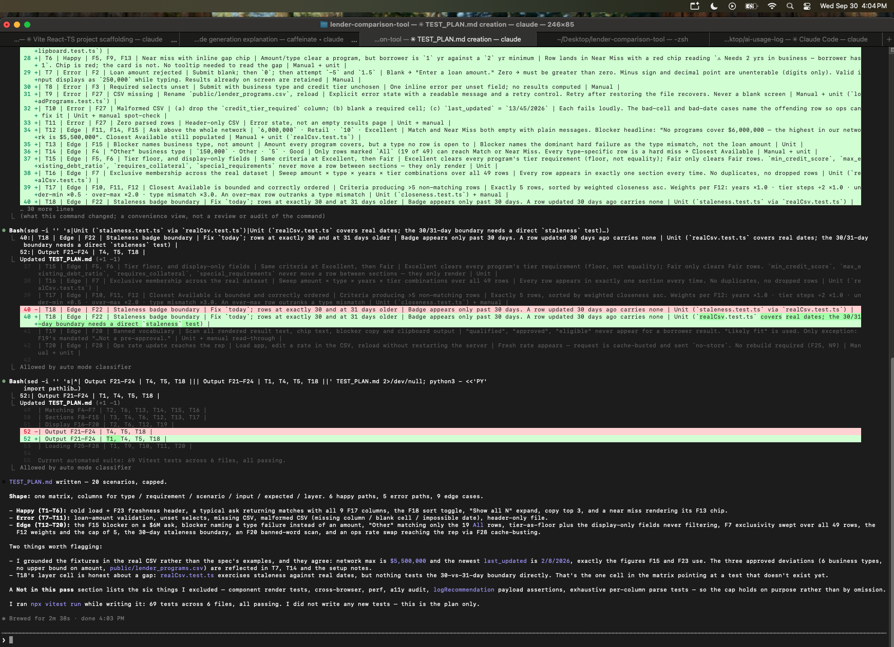

`TEST_PLAN.md`: one matrix, capped at 20 scenarios by instruction, columns for type / requirement / scenario / input / expected / layer. Six happy paths, five error paths, nine edge cases.

Two things it flagged about itself: the fixtures were grounded in the real CSV rather than the spec's examples (and they agree), and there was a genuine gap — nothing tested the 30-vs-31-day staleness boundary directly. A "Not in this pass" section lists the six things deliberately excluded, so the cap holds on purpose rather than by omission.

### 4.3 Correction 1 — stable row IDs

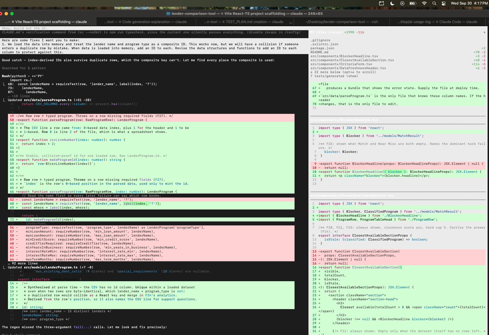

The app was using lender name + program type as a composite key, which collides if ops ever enters a duplicate row. Fix: synthesize an index-derived `id` at parse time. It survives duplicate rows, doubles as a React key, and names the actual CSV line number for support questions.

### 4.4 Correction 2 — a prop that was accepted and ignored

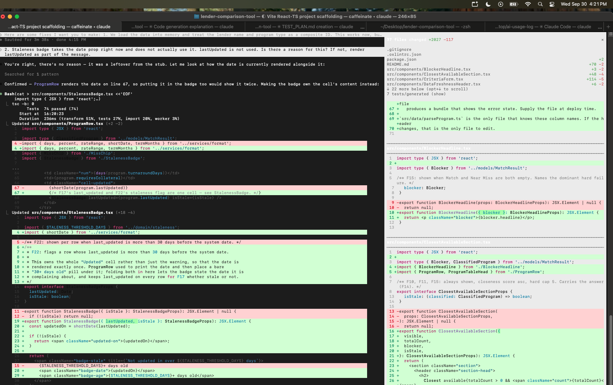

`StalenessBadge` took a `lastUpdated` prop and never used it — leftover from the stub. Rather than just rendering it (which would have printed the date twice), the badge was made to own the whole cell, so the date renders exactly once whether the row is stale or fresh.

### 4.5 Correction 3 — one bad row shouldn't kill the sheet

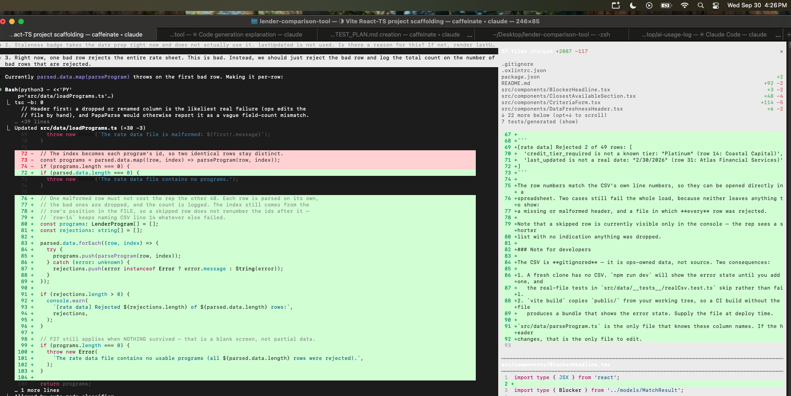

The original loader threw on the first malformed row, meaning one bad cell cost the rep all 48 good programs. Changed to per-row rejection: bad rows are dropped, the count and reasons are logged with the CSV's own line numbers, and the hard failure is reserved for the two cases where nothing is salvageable — a broken header, or every row rejected.

### 4.6 Correction 4 — new edge cases, and an honest amendment

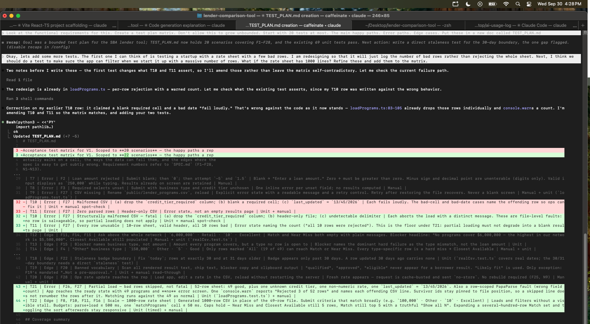

Two new scenarios requested: a rate sheet with a few bad rows, and a 1,000-row sheet for scale.

Before writing them, the model amended two existing rows in the matrix — its earlier T10 and T11 asserted "fails loudly" behavior that the code, after the previous correction, no longer had. It named the contradiction rather than leaving the matrix quietly wrong.

### 4.7 End-to-end suite

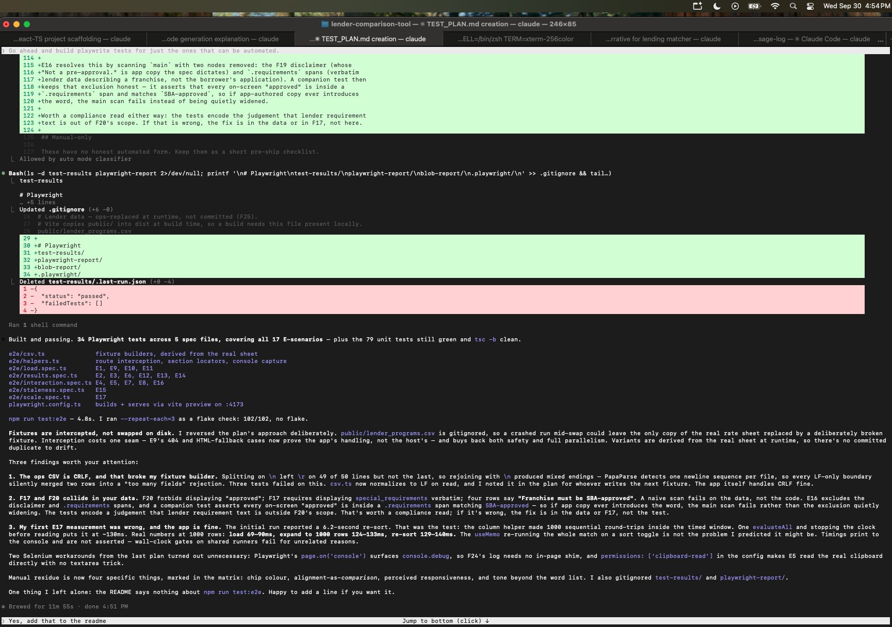

34 Playwright tests across five spec files, covering all 17 automatable scenarios, run with `--repeat-each=3` as a flake check: 102/102, no flake. Fixtures are intercepted at the network layer rather than swapped on disk, so a crashed run can't destroy the only copy of the rate sheet.

Three findings worth more than the tests themselves:
1. **The ops CSV is CRLF**, which broke the fixture builder in a way that silently merged rows.
2. **Two requirements collide in the real data** — four rows say "Franchise must be SBA-approved," which a naive banned-word scan would flag. The tests encode the judgment that lender requirement text is out of scope for that rule, so a compliance reviewer can see and challenge it.
3. **The first performance measurement was wrong and the app was fine** — a 6.2-second re-sort was an artifact of the test's own sequential round-trips, not the app. Corrected to 129–140ms.

### 4.8 Green

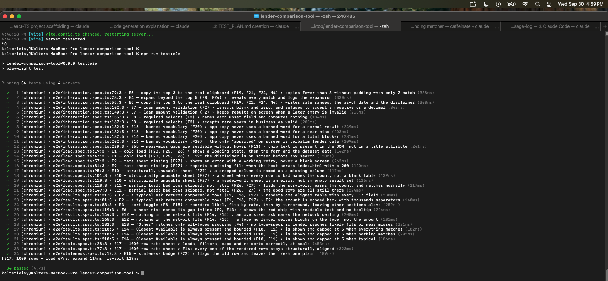

All 34 passing in 4.7 seconds — loading and error states, loan-amount validation, unset selects, missing and structurally unusable sheets, partial loads, sort toggle, clipboard copy against the real system clipboard, near-miss gap chips, the blocker headline, banned vocabulary, the closest-available cap of 5, the staleness boundary, and the 1,000-row scale case.

---

## Stage 5 — Documentation

### 5.1 Demo script

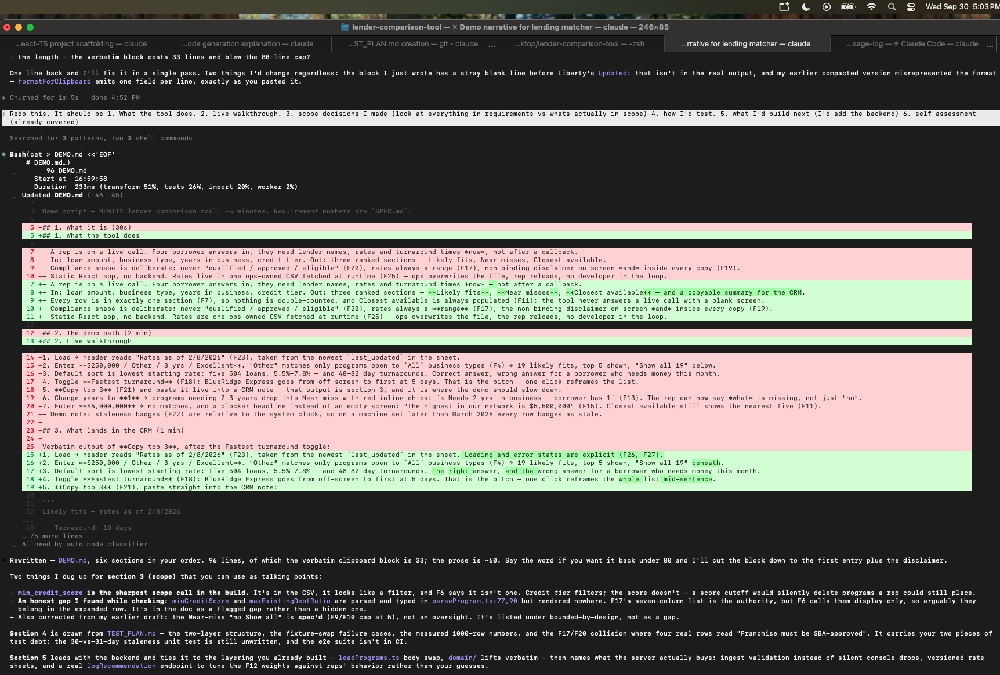

`DEMO.md` — a ~5 minute script in six sections: what the tool does, a live walkthrough, the scope decisions made and why, how it was tested, what to build next, and a self-assessment.

The walkthrough is sequenced so each step reframes the previous one, ending on the $6M no-match case. Section 3 carries two honest findings dug up while writing it: `min_credit_score` is parsed and typed but rendered nowhere (a real gap, flagged rather than hidden), and a correction to the model's own earlier draft — the near-miss "no show all" behavior is specified, not an oversight.

### 5.2 README

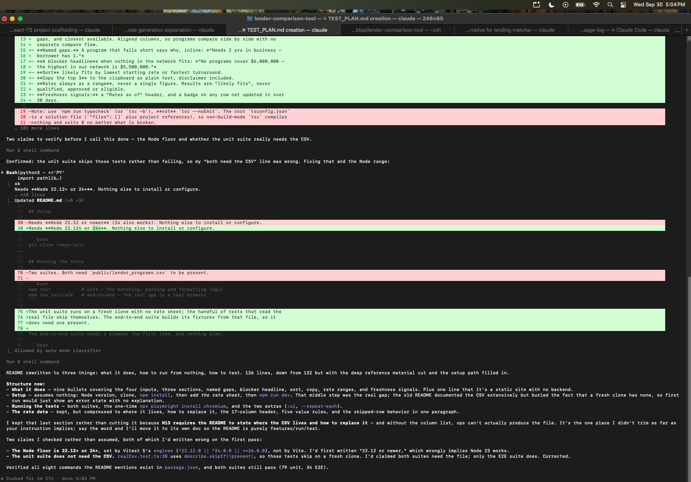

The README was rewritten to three things: what it does, how to run from nothing, how to test — 126 lines, down from 132, with reference material cut and the actual setup path filled in. The real gap in the old version: it documented the CSV extensively but buried the fact that a fresh clone doesn't have one, so a first run would show an error state with no explanation.

Two claims were checked rather than assumed, and both had been written wrong on the first pass: the Node floor is 22.12+ **or** 24+ (set by Vitest, not Vite), and the unit suite does *not* need the CSV — only the E2E suite does. All eight documented commands were verified to exist, and both suites re-run green (79 unit, 34 E2E).

---

## What the log shows

- **Planning in the browser, execution in the terminal.** The expensive thinking happened before any code existed, and it produced a numbered spec that every later prompt could cite.
- **Ambiguity was enumerated, not absorbed.** Twelve open questions with recommended leans, answered explicitly, is why there is no stage where the build quietly drifts from the brief.
- **The model was most useful when it disagreed.** The gitignored CSV, the self-contradicting test matrix, the wrong performance number, the reversed build-time recommendation, and two wrong README claims were all caught by pushing back rather than complying.
- **Tests and docs were treated as deliverables, not afterthoughts.** The test plan names what it deliberately excludes; the demo script names the one feature that's parsed but unrendered.
